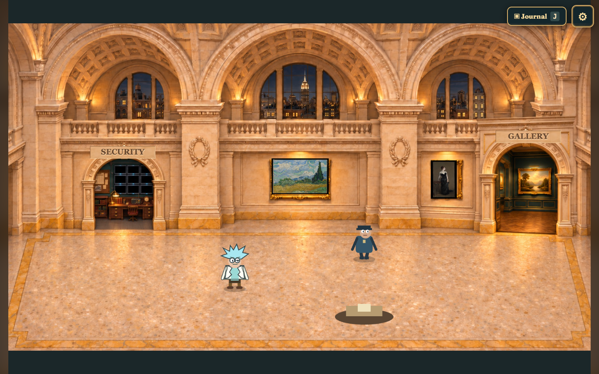

# Museum Mystery – The Night of the Forgery

[](https://github.com/florianstodden-afk/Museum-Mystery/actions/workflows/story-tests.yml)

A small top-down detective game in the browser: walk through a museum at night, solve four art stations with real works from The Met and decide what happens to a Van Gogh.

**Play it:** <https://florianstodden-afk.github.io/Museum-Mystery/>

## Team

| Name | Student number |
|---|---|
| Florian Baumgartl | 78089 |
| Florian Stodden | 78574 |
| Fabian Oscar Bergvall | 78922 |
| Leo Johannes Oskar Heppe | 79527 |

In the Git history, Fabian appears as `OliverMSchilz`, Florian Baumgartl as `FlorianBaumgartl78086`, Florian Stodden also as `florianstodden-afk` and Leo as `leomasterofcode`.



## How to play

- On the first screen, choose **Sign Up** to create a local profile, **Log In** to return to one, or **Continue as guest**. Profiles and progress still exist only on this device. See [the login flow](docs/local-login.md).
- Move with **WASD** or the **arrow keys**. Press **E** next to a marked object or a person.
- Four numbered stations, in walking order: **1 · Portraits** (Portrait Hall), **2 · Puzzle**, **3 · Catalogue** and **4 · Forgery** (Gallery, left to right). Each gives a letter that stays hidden until you solve it. Rearrange the four letters to open the vault.
- **Station 3 — Curator’s Catalogue:** match four Met artwork labels with drag, click/tap, or Tab + Enter/Space. Labels can be moved, swapped, or returned to the tray. [Artwork credits, timing and save behavior](docs/story/curators-catalogue.md).
- In the vault, answer the final question. There are two endings and up to 80 points (older completed saves retain their original rewards).
- The chosen ending has its own illustrated result screen. The real Met painting, evidence and score remain accessible. See [ending flow and implementation](docs/ending-screens.md).
- **J** opens the journal, **Esc** the menu. The hint button helps when you are stuck.
- The Home screen's **Scoreboard** shows your run and a transparent shared leaderboard. Finish a current run, then choose **Publish finished run** to submit its score. The online service must first be deployed and connected; [setup, scoring and login handoff](docs/leaderboard.md). Limits: names are not verified, and a result can be faked through the public API; the Worker still checks the format and the points cap.

## Run locally

JavaScript modules need a small web server (no build step, no packages):

```bash
python3 -m http.server 8000 --directory web
```

Then open <http://localhost:8000>.

## Run tests

```bash
cd web && node --test
```

GitHub Actions runs the same command for every pull request and after every merge to `main` (badge above). The Python files (`app.py`, `game.py`, `storage.py`, `tests/`) belong to the first Streamlit prototype. They are legacy and not part of the game; `uv run pytest` still runs them.

## Project structure

| Path | Purpose |
|---|---|
| `web/index.html`, `web/style.css`, `web/assets/investigation-journal-*.png` | Page, home screen, menu and compact illustrated journal |
| `web/main.js` | Drawing, input, rooms, connects the game to the story |
| `web/local-auth.js` | Device-only username/password profiles and separate local saves |
| `web/leaderboard.js`, `server/leaderboard/` | Shared score display and optional Cloudflare Worker/D1 service |
| `web/engine.js` | Map and movement rules |
| `web/story/` | Story engine, save, scoring, dialogues, hints, endings, sound |
| `web/minigames/` | The station mini-games and their shared UI (`station-ui.js`) |
| `web/dev/` | Preview pages, screenshots and browser checks |
| `docs/` | Work log, concept, design notes, [project history](docs/project-history.md) |

## Credits

Artworks and data: [The Metropolitan Museum of Art Collection API](https://metmuseum.github.io/), Open Access (Public Domain). [Every artwork and direct collection link](docs/art-credits.md). The museum and all characters are fictional.

## Course context

Team project for *Introduction to Programming* at Nova SBE (2026/27). Earlier decisions, the old setup guide and the full history are in [docs/project-history.md](docs/project-history.md).
