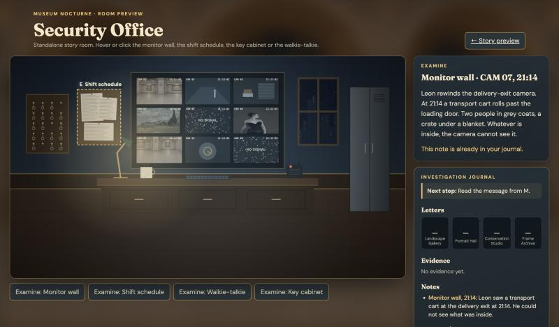

# Security Office – Einbau ins Hauptspiel (für Fabian)

Das Security Office ist ein **Story-Raum ohne Minispiel**. Es liegt komplett in `web/story/security-office/` und ändert keine bestehende Datei. Vorschau: `web/dev/security-office.html` (Server starten wie in `docs/story/README.md`).



## Dateien

| Datei | Aufgabe |
|---|---|
| `security-office.js` | Zeichnet den Raum auf ein Canvas: `drawSecurityOffice(ctx, options)`. Enthält auch `LAYOUT` (alle Möbel relativ zur Raumgröße), `monitorLayout(w, h)`, `loadSecurityOfficeBackground()` und `clockText(time)`. |
| `interactions.js` | Die vier Interaktionspunkte als Daten (`INTERACTION_POINTS`), `pointAt(relX, relY)` und `examine(state, pointId)`. |
| `security-office.png` | **Optional**, noch nicht vorhanden. Wenn die Datei da ist, wird sie als Hintergrund verwendet (Bild-Prompt im Auftrag, Anhang A). Ohne sie zeichnet der Code den Raum selbst. |

## 1. Raum zeichnen

```js
import { drawSecurityOffice, loadSecurityOfficeBackground } from './story/security-office/security-office.js';

let officeBackground = null;
loadSecurityOfficeBackground().then(image => { officeBackground = image; }); // null, wenn kein PNG da ist

// in deiner Zeichenschleife, wenn der Spieler im Security Office ist:
drawSecurityOffice(ctx, {
  width: 896, height: 576,       // die Größe, in die gezeichnet wird (bei dir: logische Canvas-Größe)
  time: now,                     // Zeit aus requestAnimationFrame (ms)
  feeds: cameraFeeds,            // bis zu 9 Funktionen, siehe unten; fehlende = "NO SIGNAL"
  background: officeBackground,  // oder null
});
```

- `drawSecurityOffice` zeichnet ab Punkt (0, 0). Wenn du den Raum woanders brauchst: vorher `ctx.translate(x, y)`.
- Das PNG wird **wie CSS `cover`** gezeichnet: Seiten werden abgeschnitten, nichts wird verzerrt.
- Die Bildschirme flackern mit ca. 12 fps (die Funktion rechnet die Zeit selbst in Bilder um). Du kannst sie 60-mal pro Sekunde aufrufen; sparsamer ist, nur alle ~83 ms neu zu zeichnen (so macht es die Vorschau).
- Die Uhr in den Bildschirmen startet bei 21:12:00 und läuft mit der echten Zeit (`time` in ms). Wenn du `time` ab Betreten des Raums zählst, erscheint nach 2 Minuten 21:14.

### Live-Ansichten (`feeds`)

Jeder Eintrag ist eine Funktion `feed(ctx, { x, y, w, h, time })`, die **nur** in dieses Rechteck zeichnet (es ist bereits per `clip()` begrenzt). Reihenfolge: links oben → rechts unten (Index 0–8).

```js
// Beispiel: Kamera auf die Great Hall – ein Ausschnitt deines Hintergrundbilds
const greatHallCam = (c, { x, y, w, h }) => c.drawImage(hallBackdrop, 0, 300, 900, 520, x, y, w, h);
const cameraFeeds = [greatHallCam, null, null, null, null, null, null, null, null];
```

Später kannst du hier echte Mini-Ansichten deiner Räume übergeben (z. B. die Räume mit kleinem Maßstab zeichnen, inkl. Wachmann-Position). Vier Beispiel-Feeds (Bildausschnitt, Korridor mit Wachmann, Lieferausgang mit Wagen, Tresortür) stehen in `web/dev/security-office-preview.js`.

## 2. Interaktionspunkte

| id | Label | Bereich (relativ: x, y, w, h) | Wirkung |
|---|---|---|---|
| `monitor-wall` | Monitor wall | 0.31, 0.08, 0.38, 0.42 | Leons Beobachtung (Wagen um 21:14, Inhalt nicht erkennbar) → Notiz `transport-cart` |
| `shift-schedule` | Shift schedule | 0.17, 0.15, 0.11, 0.25 | Wer Dienst hatte; verweist auf das Log in der Portrait Hall → Notiz `duty-roster` (löst Station 2 **nicht**) |
| `radio` | Walkie-talkie | 0.70, 0.475, 0.04, 0.075 | nur Atmosphäre |
| `key-cabinet` | Key cabinet | 0.04, 0.17, 0.11, 0.27 | nur Atmosphäre (Schlüssel zum Lieferausgang fehlt) |

Die Werte kommen aus `LAYOUT` in `security-office.js`; Zeichnung und Klickbereiche passen dadurch immer zusammen. Ein Test prüft, dass alle Bereiche im Raum liegen und sich nicht überlappen.

**Mit der Maus/dem Finger:** Klickposition in relative Werte umrechnen und `pointAt` fragen:

```js
import { pointAt, examine } from './story/security-office/interactions.js';
const point = pointAt(clickX / roomWidth, clickY / roomHeight);
if (point) {
  const result = examine(storyState, point.id);
  storyState = result.state;            // neue Notiz ist drin (nur beim ersten Mal)
  showDialog(result.title, result.text); // deine vorhandene Dialog-Funktion
}
```

**Mit Laufen + `E` (wie in der Great Hall):** Lege im Raum für jeden Punkt eine Kachel vor dem Möbelstück fest (z. B. Spielfigur steht vor dem Schreibtisch → `monitor-wall`) und rufe beim Drücken von `E` ebenfalls `examine(storyState, id)` auf. Die Kachel-Positionen hängen von deiner Karte ab und sind deshalb nicht in `interactions.js`.

`examine` gibt immer `{ state, ok, title, text, message }` zurück. Zweites Untersuchen: gleicher Text, `ok: false`, Zustand unverändert, `message` = „This note is already in your journal.“

## 3. Wenn das PNG kommt

1. Bild als `web/story/security-office/security-office.png` speichern (16:9, mind. 1672 × 941).
2. `web/dev/security-office.html` öffnen und prüfen, ob die 3×3-Bildschirme auf den gemalten Monitoren liegen.
3. Falls nicht: nur `LAYOUT.monitorWall` (und ggf. die anderen Bereiche) in `security-office.js` anpassen. `node --test` prüft danach, dass alles im Raum bleibt und sich nichts überlappt.

Hinweis: Solange das PNG fehlt, zeigt die Browser-Konsole beim Laden der Vorschau einen 404 für `security-office.png`. Das ist erwartet – danach wird der Code-Hintergrund verwendet.
