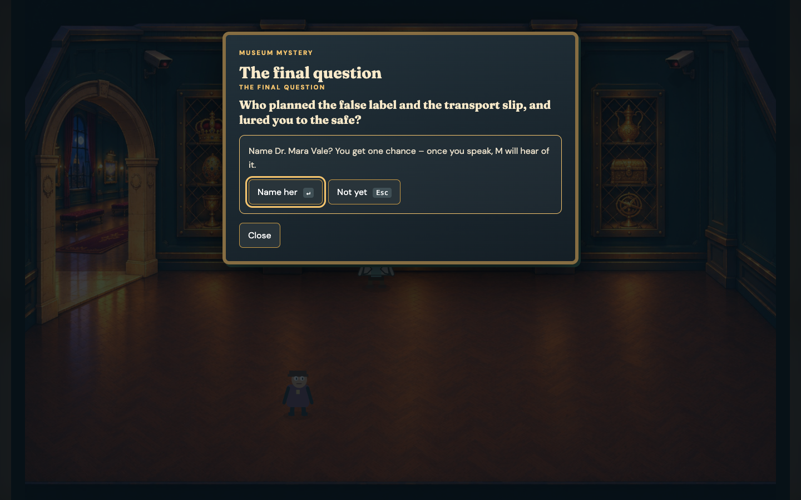
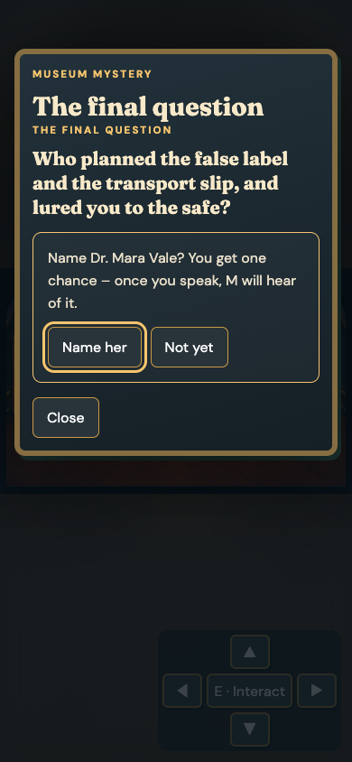
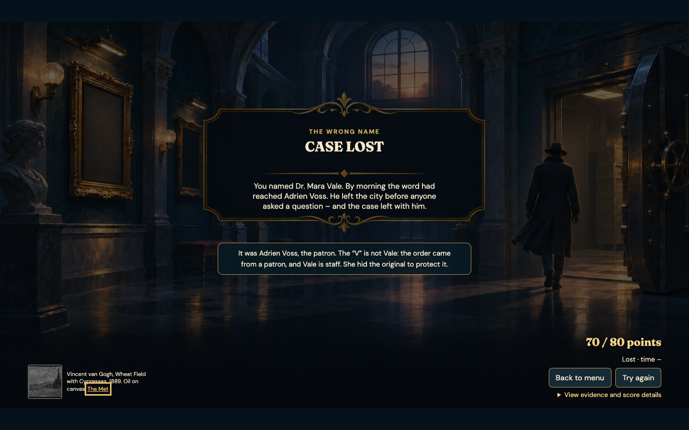
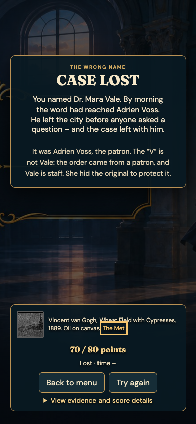
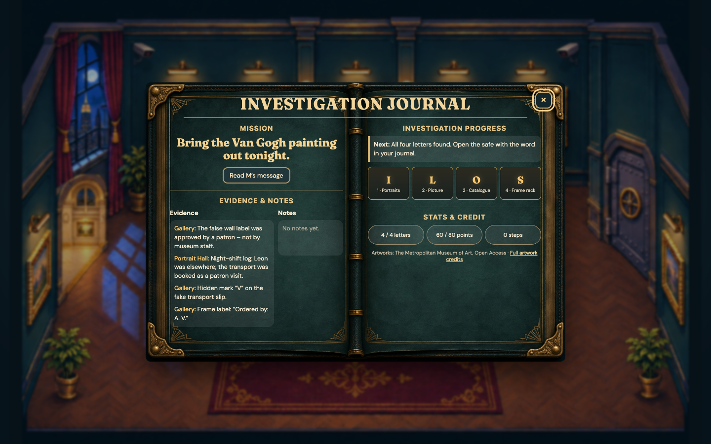
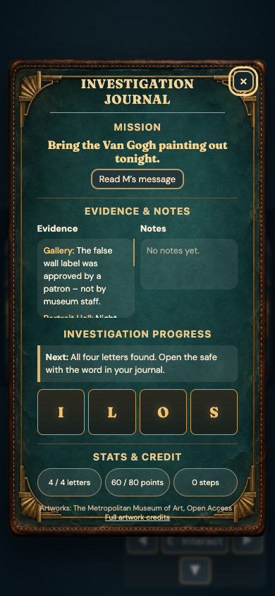

# One accusation · evidence as puzzle pieces · no "before sunrise"

Branch `feature/one-accusation-evidence`, three commits (one per point) plus one commit for the browser check.
The mini-games themselves (flow, rules, times, points) are unchanged; only the accusation logic and texts changed.

## 1 – One accusation
- `MAX_ACCUSATIONS = 1`. "Attempts left" is gone.
- Picking a suspect opens a short confirmation in the same panel. Only **Name her/him ↵** counts; **Not yet Esc** (button or Escape) goes back to the three names and counts nothing (Escape no longer closes the whole panel here).
- Right name (Voss): as before (chain of evidence, then Steal / Quit).
- Wrong name: the case ends at once with **Case lost**. The plaque names the accused; a box below says who it really was and why the accused is innocent (the suspect's `counterText`). Buttons: Try again / Back to menu.
- The state remembers the accused (`accusation.accused`). `CASE_VERSION` 2 → 3: older saves (including ones with wrong names and no ending) start fresh without a crash.
- Hints before the accusation: always two levels (general, then concrete). Story hints stay free as before.
- Lost runs: still "Lost" in the scoreboard, never a best run.

## 2 – Evidence as puzzle pieces
No text visible before the accusation names Voss any more. Together the pieces fit one person: a **patron** (stations 1, 3) with the initials **A. V.** (stations 2, 4). Dr. Vale also has a "V", but she is staff. `pointsToVoss` (chain of evidence) still names Voss, but is shown only after the right accusation or on the end screen. New test `web/story/tests/no-spoiler.test.js` checks every text a player can see before the accusation (evidence, tasks, notes, journal, hints, dialogues) and that the solution stays unique.

## 3 – "before sunrise"
There is no overall clock, so M promises no deadline any more.

## Changed texts (old → new)

| Where | Old | New |
|---|---|---|
| `case-1.js` mission (M) | … Bring it to me before sunrise. – M | … Bring it to me tonight. – M |
| `index.html` journal mission | Bring the Van Gogh painting out before sunrise. | Bring the Van Gogh painting out tonight. |
| `host.js` panel title before Steal/Quit | Before sunrise | Your decision |
| Station 3 evidence (`false-label`) | Voss approved the false wall label. | The false wall label was approved by a patron – not by museum staff. |
| Station 3 chain (`pointsToVoss`) | The false label went up with Voss’s approval – he wanted the swap to look official. | A patron, not the staff, approved the false label – Voss wanted the swap to look official. |
| Station 4 evidence (`frame-label`) | Frame label: “Ordered by: A. Voss”. | Frame label: “Ordered by: A. V.” |
| Station 4 chain (`pointsToVoss`) | The frame for the forgery was ordered by A. Voss – so the “V” is his, not Vale’s. | The frame for the forgery was ordered by “A. V.” – Adrien Voss, the only patron with those initials, not Vale. |
| Vale `counterText` | The “V” is not Vale: the frame label says “Ordered by: A. Voss”. Vale hid the original to protect it. | The “V” is not Vale: the order came from a patron, and Vale is staff. She hid the original to protect it. |
| Confirmation (new) | – | Name [name]? You get one chance – once you speak, M will hear of it. · Buttons: Name her/him ↵ · Not yet Esc |
| Accusation view | Attempts left: 3 / 2 / 1 | (removed) |
| Wrong-name message | Not [name]. [counterText] Try again. / … That was your last chance. Case lost. | Not [name]. That was your only chance. Case lost. |
| Case lost kicker | BEFORE SUNRISE | THE WRONG NAME |
| Case lost text | You named the wrong person three times. By sunrise, Voss and the original are gone. The museum will never know who planned it. | You named [name]. By morning the word had reached Adrien Voss. He left the city before anyone asked a question – and the case left with him. |
| Case lost, second part (new) | – | It was Adrien Voss, the patron. [counterText of the accused] |
| Case lost details intro | Three wrong names. The evidence you found is listed below. | One wrong name. The evidence you found is listed below. |
| Hint level 1 (accusation) | Line up the four pieces of evidence. One name keeps coming back – and the “V” is not who you might think. | Line up the four pieces of evidence: who approved the label, who booked the cart, whose “V” is it? |
| Hint level 2 (accusation) | Look at the frame label from the Gallery frame rack: whose name is on it? And who would book a “patron visit”? | A patron, initials A. V. – who fits both? |
| Score row "Final question" | n wrong answer(s) | right name / wrong name |
| README | … You have three tries. … Three wrong names end the night with Case lost. | … You have one accusation … A wrong name ends the night at once with Case lost … |

The confirmation says "M will hear of it" instead of "Voss will hear of it" (the brief's example): naming Voss there would give the answer away before the accusation.

## Screenshots (1440×900 and 390×844)

| | Desktop | Phone |
|---|---|---|
| Confirmation |  |  |
| Case lost |  |  |
| Journal, new evidence |  |  |

## Checks
- `cd web && node --test`: 326 pass, 0 fail. `node --test server/leaderboard/worker.test.js`: 4 pass.
- Browser (`web/dev/e2e-accusation.mjs`, Chrome over the DevTools protocol, 56 checks at both sizes): right name + Steal, right name + Quit, wrong name Vale → Case lost, cancel by "Not yet" and by Escape (nothing counted), journal with the new evidence. Console without errors. The runs start from a seeded save at the vault (all stations solved via the engine); the mini-games were not replayed, since they did not change.
- No scrolling in the confirmation and the Case lost screen. Journal: on desktop the evidence list now fits (on `main` it already scrolled inside its box, 217/140 px). On the phone the evidence list still scrolls inside its box, as on `main`; the mission page no longer runs into the progress page (it overlapped by 30 px on `main`).

🤖 Generated with [Claude Code](https://claude.com/claude-code)
