# Story clarity: M, Leon, Imani, Vale

Text-only changes, so that a new player understands the story without prior knowledge: the Van Gogh in the Gallery is a copy, Dr. Vale locked the original in her safe out of caution, the 21:14 cart came for it and left empty, Leon is an honest guard, Imani quietly spots the fake, Voss planned everything, and only the player and M know about the theft. No changes to game flow, mini-games, points, accusation logic or layout.

One commit per section (sections 5 and 6 together), plus a browser check with screenshots.

## Changed texts (old → new)

| Where | Old | New |
|---|---|---|
| **M** · mission (`case-1.js`) | The Museum Nocturne is yours tonight. A safe holds Van Gogh’s “Wheat Field with Cypresses”. Four stations hide the way in. Bring it to me tonight. – M | The Van Gogh in the Gallery is a copy. The real ‘Wheat Field with Cypresses’ is locked in the curator’s safe. She hid four clues in the museum – together they open it. Everyone thinks you are the new conservation temp. Bring me the painting tonight. – M |
| **M** · safe still closed | Keep moving. Four wings, four clues. / The curator thinks she is clever. Her clues will spell the way into the safe. | Four stations, four letters. Put them together and the safe is yours. |
| Hint (stations open) | Four wings, four clues. Still open: … | Four stations, four letters. Still open: … |
| **Leon** · greeting | Evening. Keep your voice down – the cameras have ears tonight. | Evening. You must be the new conservation temp. Quiet night – mostly. |
| **Leon** · goodbye | Mind the cameras. | Gloves on before you touch anything. |
| **Leon** · before the cart note | I know how it looks. I was on duty, and a painting is missing. / At 21:14 I saw a transport cart at the delivery exit. I never saw what was inside. / If you don’t believe me, look at the monitor wall in the security office. | At 21:14 a covered transport cart left the delivery exit. / Nobody told me about a delivery. I couldn’t see what was on it. / The monitors in the security office recorded it. |
| **Leon** · after the cart note | (same first two lines) / The night-shift log is in the Portrait Hall. It will show where I really was. | I know – the guard always looks guilty first. / The night-shift log hangs in the Portrait Hall. It shows where I was at 21:14. |
| **Leon** · after Station 1 | The log proves it, doesn’t it? I was on the east stairs at 21:14. / Someone booked that cart as a “patron visit”. Not me – guards cannot book anything. | East stairs at 21:14 – signed in the log. I couldn’t have moved that cart. / And it was booked as a ‘patron visit’. Guards can’t book visits. |
| **Leon** · “Rough night so far?” | own lines per stage (“Rough? A cart rolled out …”, “So you’ve seen the footage …”, “I can’t book a coffee …”) | the same lines as his main dialogue for each stage (no duplicates) |
| **Leon** · suspect description | Saw a transport cart at the delivery exit, but not the painting. Nervous since the alarm. | Night guard. Saw a covered cart leave at 21:14 – and was on duty all night. |
| **Leon** · `counterText` | The night-shift log shows Leon was on his round elsewhere – and the transport was booked as a patron visit, not by a guard. | The night-shift log puts Leon on the east stairs at 21:14, and a guard cannot book a patron visit. |
| **Imani** · before Station 2 | The picture puzzle is on the left side of the Gallery, beside Curator’s Catalogue and the frame rack. / Restore Renoir’s Sea and Cliffs at Station 2. I will then use the lamp to reveal the mark on the transport slip. | Between us – have you looked at the Van Gogh in the Gallery? The varnish is still sticky. / A painting from 1889 isn’t. I haven’t told anyone yet. / Behind the Renoir puzzle at Station 2 there is a transport slip. Restore it, and I’ll check it under my lamp. |
| **Imani** · after Station 2 | That “V” was written in an ink that only shows under the lamp. / Someone wanted to recognise their own paperwork. A “V” – that could be more than one person here. | Under my lamp the slip shows a hidden ‘V’. Whoever booked that cart marked it. / But one letter can fit more than one person in this museum. |
| **Imani** · safe open | The original was in the safe all along? Then the one on the wall … / I will test its varnish in the morning. Fresh varnish never lies. | The original was in the safe? Then Dr. Vale had doubts too. |
| **Vale** · safe open, before the accusation | You opened it. Good. I locked the original away the night the false label went up. / I could not tell anyone – not even Leon. So I left four clues and hoped the right person would follow them. / Now tell me: who is behind this? | You opened it. That new wall label in the Gallery never looked right to me – so I locked the original in here, just in case. / The cart at 21:14 came for it and left empty. / Someone needed my clues to get in. So – who sent you, and who is behind this? |
| **Vale** · after the right accusation (first line) | Voss. I suspected him for weeks, but I needed proof that was not mine. | Voss. That label had his taste all over it – but I needed proof that wasn’t mine. |
| **Vale** · after Case lost | Dr. Vale stands in front of the open safe. / The original is gone. So is the patron who planned it. | Dr. Vale stands in front of the open safe. / The original is still there. The patron who planned it is gone. |
| **Vale** · suspect description | Locked the original in the safe and left four clues. Her initial is also a “V”. | Curator. Locked the original in the safe and left four clues. Her initial is also a ‘V’. |
| **Vale** · `counterText` | The “V” is not Vale: the order came from a patron, and Vale is staff. She hid the original to protect it. | The ‘V’ is not Vale. The frame label names ‘A. V.’, not M. V. – and Vale hid the original to protect it. |
| Note “Monitor wall, 21:14” | Leon saw a transport cart at the delivery exit at 21:14. He could not see what was inside. | A covered transport cart left the delivery exit at 21:14. No delivery was announced. |
| Station 1 evidence (`shift-log`) | Night-shift log: Leon was elsewhere; the transport was booked as a patron visit. | Night-shift log: Leon was on the east stairs at 21:14, when the cart left. The cart was booked as a ‘patron visit’. |

### Deliberate deviations from the brief
- **Vale’s second line** is split into two boxes (“The cart at 21:14 came for it and left empty.” / “Someone needed my clues …”), because a box holds at most two short sentences.
- **Vale `counterText`**: the brief says “The frame label names A. Voss”, but since the last PR the frame label only says “Ordered by: A. V.”. The text now says so (“names ‘A. V.’, not M. V.”).
- **Leon `counterText`** is shorter than in the brief: the Case lost screen allows at most 30 words for “It was Adrien Voss, the patron.” plus the counter text (existing test).
- **Lost ending**: Vale’s old line “The original is gone” contradicted the story (the original stays in the safe), so it now says it is still there.

## Journal: letters in code-word order
The journal now shows the letter slots in code-word order **O-I-L-S** (each still labelled with its station number: 3 · Catalogue, 1 · Portraits, 2 · Picture, 4 · Frame rack) instead of station order (I-L-O-S). Tests in `content.test.js` updated; README adjusted.

## Screenshots (1440×900 and 390×844)

| | Desktop | Phone |
|---|---|---|
| M’s message | 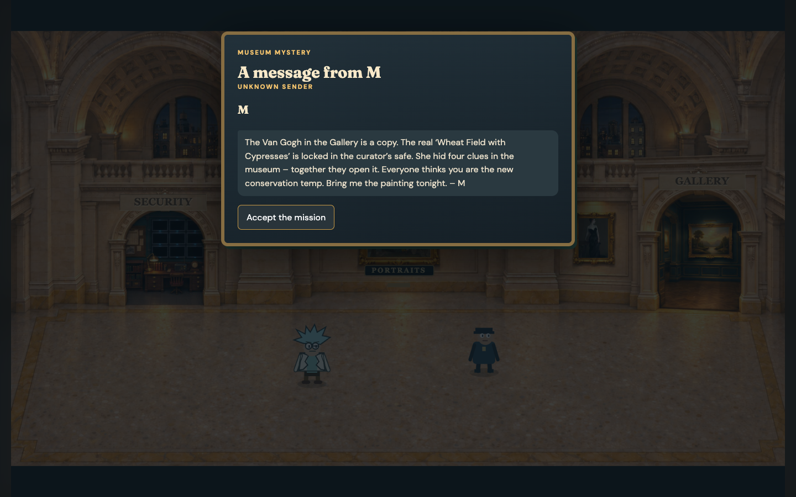 | 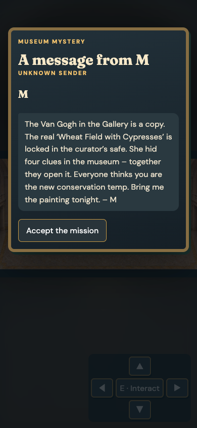 |
| M, safe closed | 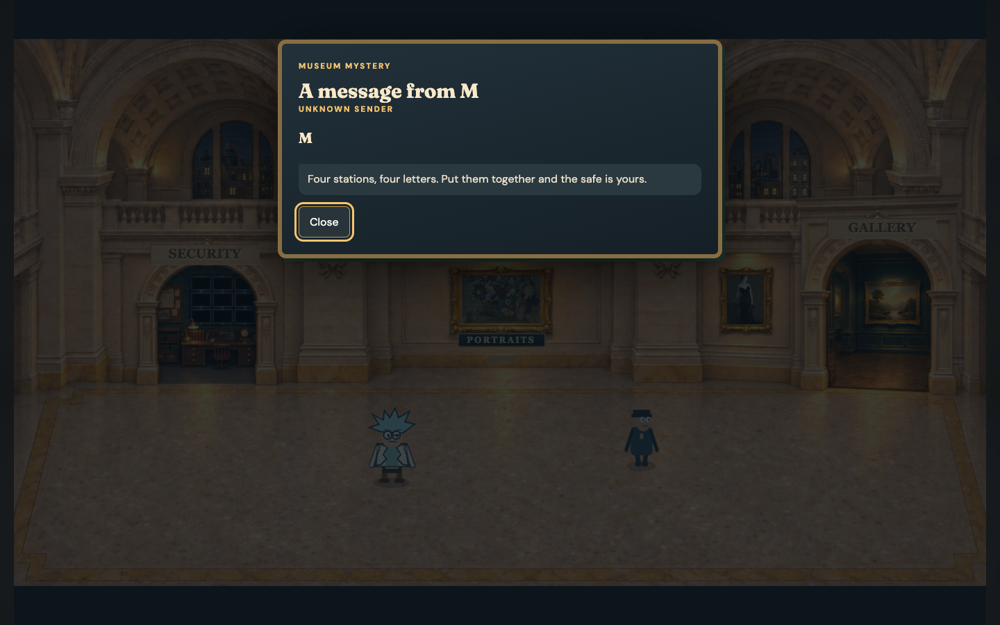 | 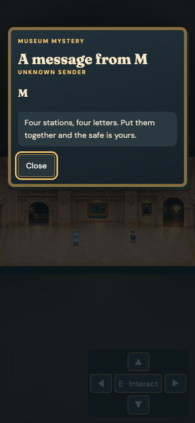 |
| Leon before Station 1 | 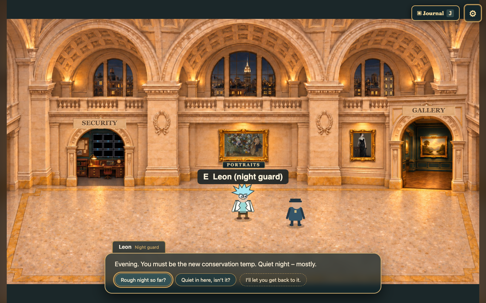 | 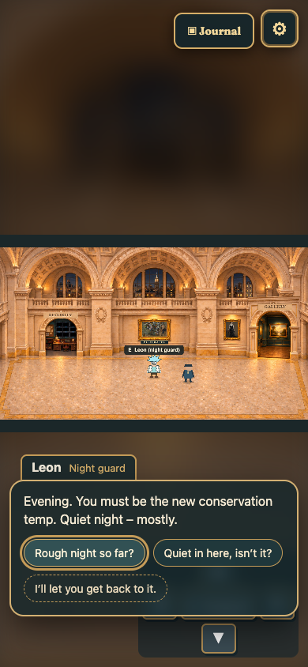 |
| Leon after Station 1 | 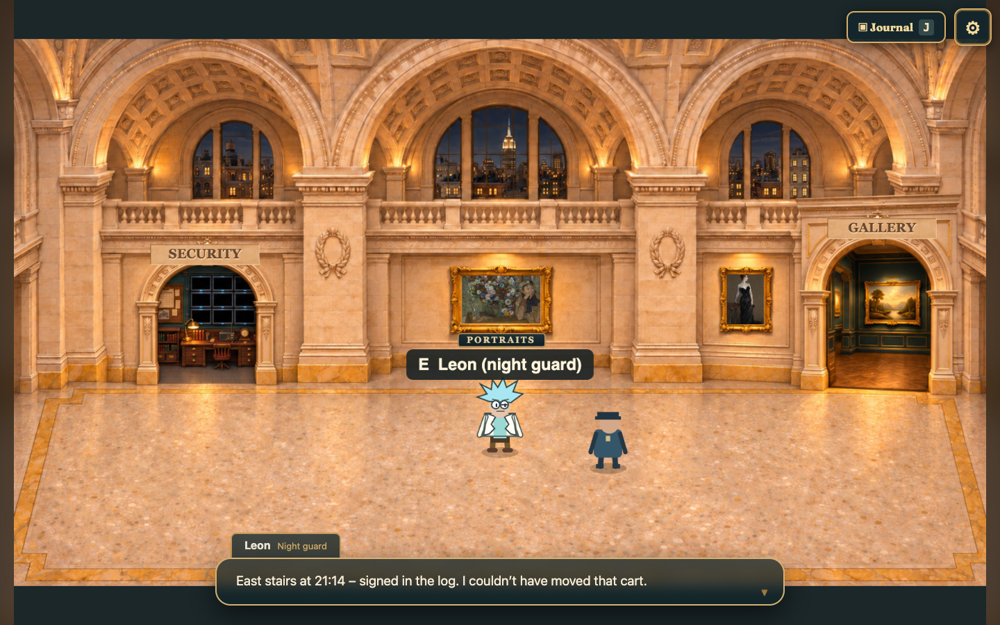 | 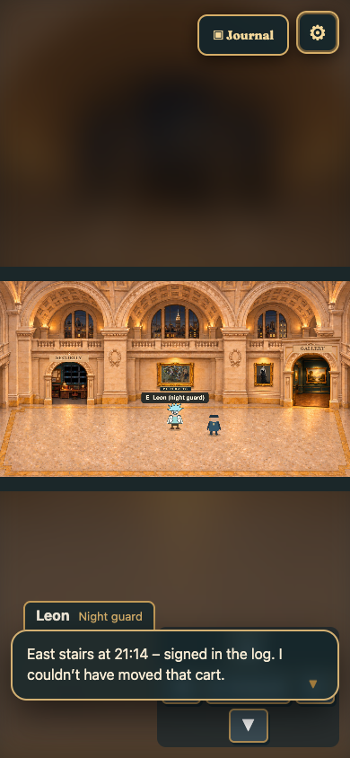 |
| Imani before Station 2 | 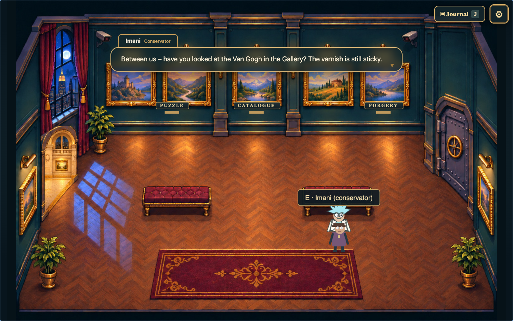 | 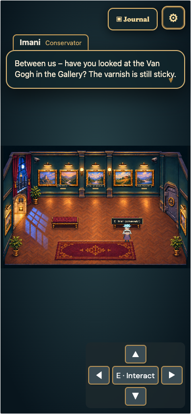 |
| Imani after Station 2 |  | 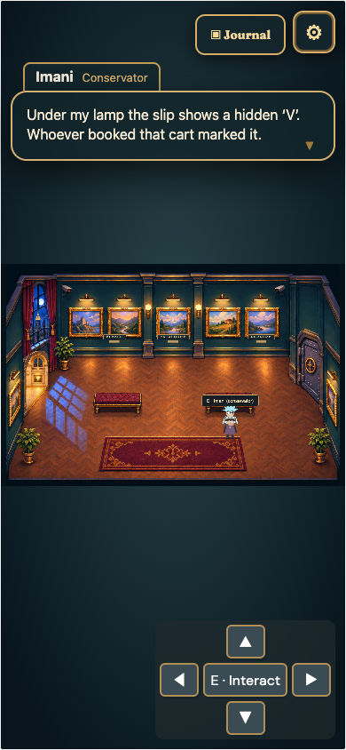 |
| Vale at the open safe | 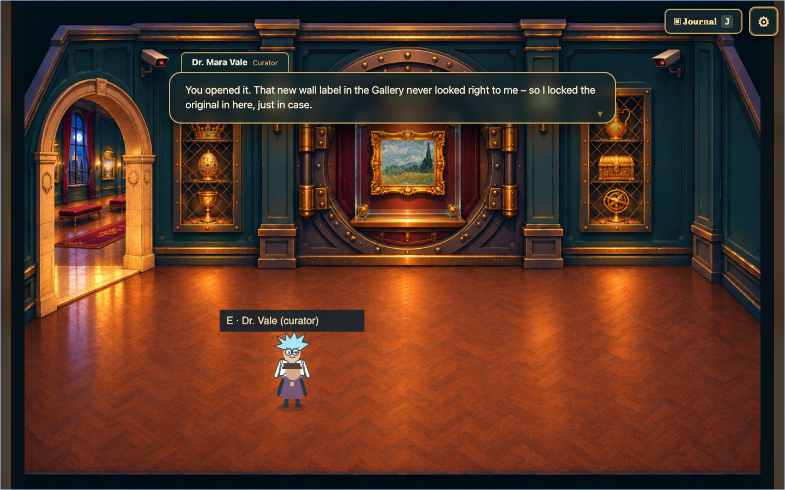 | 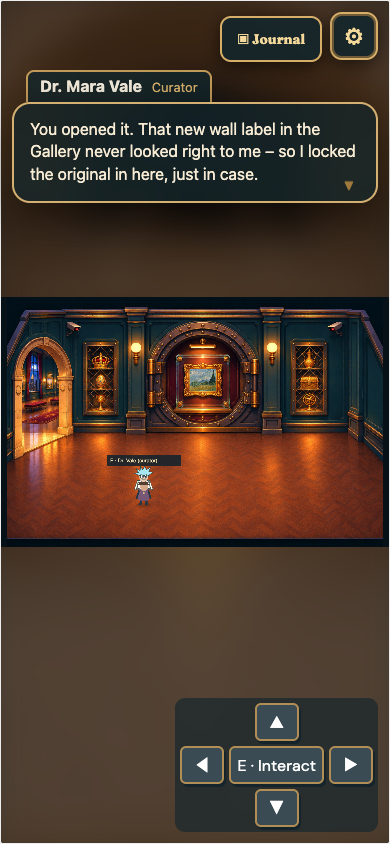 |

## Checks
- `node --test` (repo root, as in CI): 339 pass, 0 fail. `cd web && node --test`: 332 pass.
- Browser (`web/dev/e2e-story-dialogues.mjs`, Chrome over the DevTools protocol): 16 checks at both sizes, console without errors. Each scene starts from a seeded save at the right story stage; the mini-games were not replayed (unchanged).
- New tests: no “alarm”, “painting is missing”, “cameras have ears” or “sunrise” in any text before the accusation; Leon’s “Rough night” matches his main lines; no text before the accusation names Voss (existing no-spoiler test, still green).
- Docs: `docs/text-audit.md` (rows + “Story clarity update”), `docs/story/story-check.md` (the story a new player should understand), `docs/game-concept.md`, `docs/story/minigame-contract.md`.

🤖 Generated with [Claude Code](https://claude.com/claude-code)
